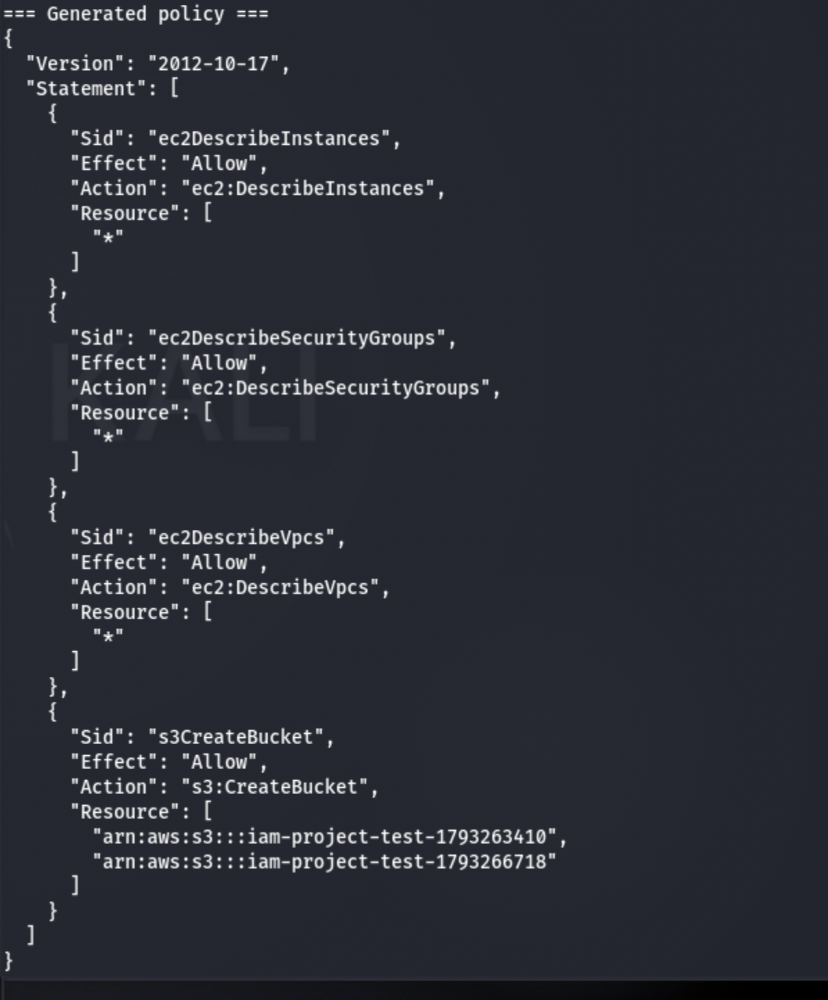
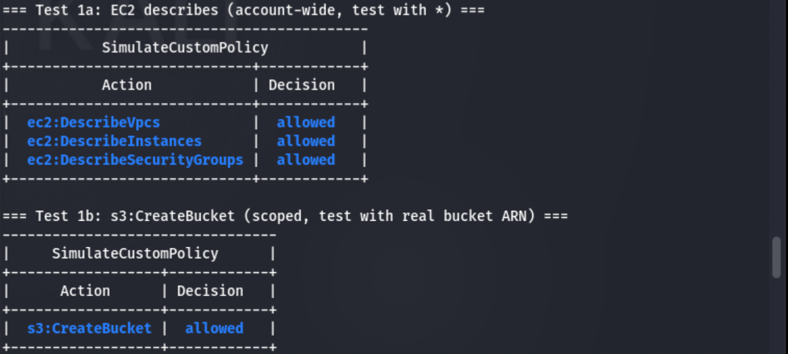
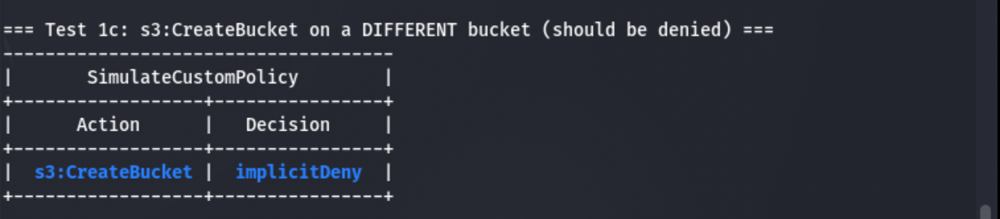
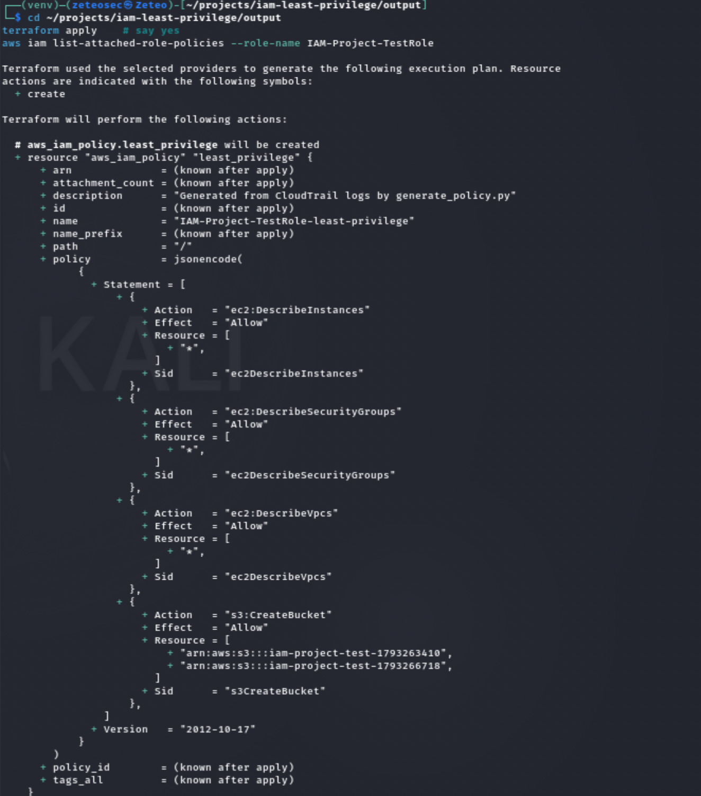

# IAM Least-Privilege Generator

A Python CLI tool that analyzes CloudTrail logs for an IAM role and generates a hardened, least-privilege IAM policy, plus deployable Terraform.

**Result in this lab:** a role with ~400 permissions reduced to **4**, with validated allow/deny proof.

This is my project. I built it to solve the #1 finding in cloud security assessments: over-privileged IAM roles.

---

## The Problem

IAM roles are almost always over-privileged. A workload needs to read one S3 bucket, so someone attaches `AmazonS3FullAccess`, and now that role can read, write, and delete *every bucket in the account*. When that role's credentials are compromised, the blast radius is the entire account.

This is the #1 finding in cloud security assessments. The fix is least privilege, but manually writing a minimal policy is slow, error-prone, and doesn't scale past a handful of roles.

---

## What This Tool Does

1. Reads CloudTrail logs for a specific IAM role
2. Extracts every API call the role actually made
3. Maps those calls to IAM actions and resource ARNs
4. Generates a minimal IAM policy containing only those permissions
5. Outputs deployable Terraform to apply the policy

**Input:** CloudTrail `.json.gz` log files  
**Output:** `least_privilege.json`, `main.tf`, `crud.yml`

---

## Before / After

| | Before | After |
|---|---|---|
| **Policies attached** | `AmazonS3FullAccess` + `AmazonEC2FullAccess` | 1 generated custom policy |
| **Actions granted** | ~400 | **4** |
| **Resources** | `*` (everything in the account) | 2 specific S3 buckets + 3 account-wide describes |
| **Can delete a bucket?** | Yes | **No** |
| **Can launch a server?** | Yes | **No** |
| **Can create admin users?** | Yes | **No** |
| **Can create a bucket with a different name?** | Yes | **No** |

### Generated policy

```json
{
  "Version": "2012-10-17",
  "Statement": [
    {
      "Sid": "ec2DescribeInstances",
      "Effect": "Allow",
      "Action": "ec2:DescribeInstances",
      "Resource": ["*"]
    },
    {
      "Sid": "ec2DescribeSecurityGroups",
      "Effect": "Allow",
      "Action": "ec2:DescribeSecurityGroups",
      "Resource": ["*"]
    },
    {
      "Sid": "ec2DescribeVpcs",
      "Effect": "Allow",
      "Action": "ec2:DescribeVpcs",
      "Resource": ["*"]
    },
    {
      "Sid": "s3CreateBucket",
      "Effect": "Allow",
      "Action": "s3:CreateBucket",
      "Resource": [
        "arn:aws:s3:::iam-project-test-1793263410",
        "arn:aws:s3:::iam-project-test-1793266718"
      ]
    }
  ]
}
```

---

## Screenshots

### Before: role with over-broad policies


### After: generated 4-action policy



### Validation: actions the role actually used are allowed



### Validation: dangerous actions the role never used are denied



### Scoping proof: `s3:CreateBucket` denied on a different bucket



---

## Architecture

```text
┌──────────────┐
│   IAM User   │
└──────┬───────┘
       │ assume-role
       ▼
┌───────────────────────────────┐
│  IAM-Project-TestRole         │
│  (over-privileged:            │
│   S3FullAccess + EC2Full)     │
└──────┬────────────────────────┘
       │ API calls (CreateBucket, DescribeVpcs, …)
       ▼
┌───────────────────────────────┐
│  CloudTrail Trail             │
│  (management + S3 data events)│
└──────┬────────────────────────┘
       │ writes .json.gz
       ▼
┌───────────────────────────────┐
│  S3 Log Bucket                │
└──────┬────────────────────────┘
       │ aws s3 sync
       ▼
┌───────────────────────────────┐
│  logs/cloudtrail_trail/       │
└──────┬────────────────────────┘
       │ python scripts/generate_policy.py
       ▼
┌───────────────────────────────┐
│  output/                      │
│   ├── least_privilege.json    │
│   ├── main.tf                 │
│   └── crud.yml                │
└───────────────────────────────┘
```

---

## Using This on Your Own AWS Account

You don't need the lab setup if you already have an IAM role and CloudTrail logging enabled for its activity.

### 1. Export the role's CloudTrail logs

If you have a trail writing to S3 (recommended, captures S3 data events):

```bash
aws s3 sync s3://YOUR-LOG-BUCKET/AWSLogs/YOUR_ACCOUNT_ID/CloudTrail/ logs/cloudtrail_trail/
```

If you only have Event History (management events only, last 90 days):

```bash
aws cloudtrail lookup-events \
  --lookup-attributes AttributeKey=ResourceName,AttributeValue=YOUR_ROLE_NAME \
  --start-time 2025-01-01T00:00:00Z \
  --end-time 2025-01-31T23:59:59Z \
  --output json > logs/cloudtrail_logs.json
```

> **Note:** Event History only returns management events. S3 `PutObject`/`GetObject` require a trail with S3 data events enabled.

### 2. Generate the policy

```bash
python scripts/generate_policy.py \
  --logs-dir logs/cloudtrail_trail \
  --role-name YOUR_ROLE_NAME \
  --output-dir output
```

### 3. Review and validate

```bash
cat output/least_privilege.json | jq .

POLICY_DOC=$(cat output/least_privilege.json | jq -c .)

aws iam simulate-custom-policy \
  --policy-input-list "$POLICY_DOC" \
  --action-names "s3:CreateBucket" "ec2:DescribeVpcs" \
  --resource-arns "*" \
  --query 'EvaluationResults[].{Action: EvalActionName, Decision: EvalDecision}' \
  --output table
```

### 4. Deploy

```bash
cd output
terraform init
terraform apply
```

> **Important:** this attaches the new policy but does **not** detach the old over-broad policies. Detach them manually after verifying the new policy works:

> ```bash
> aws iam detach-role-policy \
>   --role-name YOUR_ROLE_NAME \
>   --policy-arn arn:aws:iam::aws:policy/AmazonS3FullAccess
> ```

---

## Reproducing the Lab (What I Built)

### 1. Create the lab environment

```bash
# Create role with over-broad permissions
aws iam create-role \
  --role-name IAM-Project-TestRole \
  --assume-role-policy-document file://scripts/trust-policy.json

aws iam attach-role-policy \
  --role-name IAM-Project-TestRole \
  --policy-arn arn:aws:iam::aws:policy/AmazonS3FullAccess

aws iam attach-role-policy \
  --role-name IAM-Project-TestRole \
  --policy-arn arn:aws:iam::aws:policy/AmazonEC2FullAccess
```

### 2. Enable CloudTrail logging

Create an S3 bucket, attach the CloudTrail bucket policy, create the trail, enable S3 data events, and start logging.

```bash
BUCKET="cloudtrail-logs-$(date +%s)-$RANDOM"
ACCOUNT_ID=$(aws sts get-caller-identity --query 'Account' --output text)

aws s3 mb s3://$BUCKET

cat > /tmp/cloudtrail-bucket-policy.json << EOF
{
  "Version": "2012-10-17",
  "Statement": [
    {
      "Sid": "AWSCloudTrailAclCheck",
      "Effect": "Allow",
      "Principal": { "Service": "cloudtrail.amazonaws.com" },
      "Action": "s3:GetBucketAcl",
      "Resource": "arn:aws:s3:::${BUCKET}"
    },
    {
      "Sid": "AWSCloudTrailWrite",
      "Effect": "Allow",
      "Principal": { "Service": "cloudtrail.amazonaws.com" },
      "Action": "s3:PutObject",
      "Resource": "arn:aws:s3:::${BUCKET}/AWSLogs/${ACCOUNT_ID}/*",
      "Condition": {
        "StringEquals": { "s3:x-amz-acl": "bucket-owner-full-control" }
      }
    }
  ]
}
EOF

aws s3api put-bucket-policy --bucket $BUCKET --policy file:///tmp/cloudtrail-bucket-policy.json

aws cloudtrail create-trail --name iam-project-trail --s3-bucket-name $BUCKET --is-multi-region-trail

aws cloudtrail put-event-selectors \
  --trail-name iam-project-trail \
  --event-selectors '[{
    "ReadWriteType": "All",
    "IncludeManagementEvents": true,
    "DataResources": [{
      "Type": "AWS::S3::Object",
      "Values": ["arn:aws:s3:::iam-project-test-*/"]
    }]
  }]'

aws cloudtrail start-logging --name iam-project-trail
```

### 3. Generate activity

```bash
./scripts/regenerate.sh
```

This assumes the role and makes a narrow set of S3 and EC2 API calls.

### 4. Wait, sync, generate

```bash
# Wait 10-15 minutes for CloudTrail to batch the logs
aws s3 sync s3://$BUCKET/AWSLogs/$ACCOUNT_ID/CloudTrail/ logs/cloudtrail_trail/

python scripts/generate_policy.py \
  --logs-dir logs/cloudtrail_trail \
  --role-name IAM-Project-TestRole \
  --output-dir output
```

---

## Validation

The generated policy was validated with `aws iam simulate-custom-policy`.

### Allowed, actions the role actually used

| Action | Resource | Decision |
|--------|----------|----------|
| `ec2:DescribeVpcs` | `*` | allowed |
| `ec2:DescribeInstances` | `*` | allowed |
| `ec2:DescribeSecurityGroups` | `*` | allowed |
| `s3:CreateBucket` | `arn:aws:s3:::iam-project-test-1793266718` | allowed |

### Denied, dangerous actions the role never used

| Action | Resource | Decision |
|--------|----------|----------|
| `s3:DeleteBucket` | `*` | implicitDeny |
| `s3:PutObject` | `*` | implicitDeny |
| `s3:GetObject` | `*` | implicitDeny |
| `ec2:TerminateInstances` | `*` | implicitDeny |
| `ec2:RunInstances` | `*` | implicitDeny |
| `iam:CreateUser` | `*` | implicitDeny |
| `s3:PutBucketPolicy` | `*` | implicitDeny |

### Scoping proof

| Action | Resource | Decision |
|--------|----------|----------|
| `s3:CreateBucket` | `arn:aws:s3:::some-other-bucket` | implicitDeny |

This proves the policy is scoped, it doesn't grant blanket `CreateBucket`, only on the two buckets the role actually created.

---

## What I Learned / What I'd Do Differently

**1. CloudTrail does not capture S3 data events by default.**

The trail initially recorded only management events (`CreateBucket`), not data-plane operations (`PutObject`, `GetObject`, `DeleteObject`). I enabled S3 data events with `put-event-selectors`, but the batches hadn't landed within the capture window. **In production, enable data events before capturing the activity window, and wait 15+ minutes after enabling before running the workload.**

**2. IAM policy simulation is context-sensitive.**

Testing `s3:CreateBucket` with `--resource-arns "*"` returned `implicitDeny` even though the policy grants it on two specific buckets. Not a policy bug, the simulator evaluates against the resource you pass, and `"*"` is broader than what the policy grants. **Always test with the resource the policy actually scopes to.**

**3. EC2 describe actions are account-wide.**

`ec2:DescribeVpcs`, `ec2:DescribeInstances`, and `ec2:DescribeSecurityGroups` don't support resource-level scoping in IAM. The tool correctly generates `"Resource": "*"` for them because that's what the policy requires.

**4. Destructive test-cleanup actions are not real permission needs.**

The role deleted the bucket it created during the test. Without a filter, `s3:DeleteBucket` would appear in the policy, implying the role needs delete permissions in production, which it doesn't. The tool skips these via `SKIP_ACTIONS`.

**5. The Terraform attaches but does not detach.**

`terraform apply` adds the new least-privilege policy but leaves the old over-broad policies attached. Achieving actual least privilege requires manually detaching the old policies after verifying the new one works. Documented in the "Using This on Your Own AWS Account" section.

**6. Idempotent detach would be better.**

During the demo, `detach-role-policy` for `AmazonS3FullAccess` returned `NoSuchEntity` because it had already been detached in a prior run. A production tool should check `list-attached-role-policies` first, or use `--ignore-errors` semantics.

### Future work

- Integrate `policy_sentry` for wildcard minimization and resource-type inference
- Add a `--time-window` flag to scope logs to a single activity run
- Compare generated policies against AWS IAM Access Analyzer's native findings
- Add drift detection (re-run periodically, alert on new permissions used)

---

## Repo Structure

```text
iam-least-privilege/
├── scripts/
│   ├── generate_policy.py      # the tool
│   ├── regenerate.sh           # re-run lab activity
│   └── trust-policy.json       # role trust policy
├── output/                     # generated policies (gitignored)
├── logs/                       # CloudTrail logs (gitignored)
├── docs/
│   └── screenshots/            # validation screenshots
├── requirements.txt
└── README.md
```

---

## Requirements

- Python 3.8+
- AWS CLI v2, authenticated (`aws sts get-caller-identity` should work)
- Terraform 1.0+ (only for deployment)
- IAM permissions: `iam:CreateRole`, `iam:AttachRolePolicy`, `iam:CreatePolicy`, `cloudtrail:*`, `s3:*`, `ec2:Describe*`

---

## References

- [CloudTrail record contents](https://docs.aws.amazon.com/awscloudtrail/latest/userguide/cloudtrail-event-reference-record-contents.html)
- [IAM policy simulation](https://docs.aws.amazon.com/IAM/latest/UserGuide/access_policies_testing-policies.html)
- [AWS IAM Access Analyzer](https://docs.aws.amazon.com/IAM/latest/UserGuide/what-is-access-analyzer.html), AWS's native CIEM equivalent
- [Policy Sentry](https://policy-sentry.readthedocs.io/)

---

*Built by [@0xZeteo](https://github.com/0xZeteo)*
